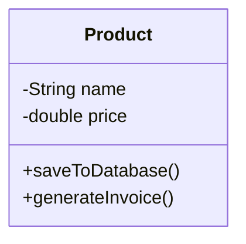
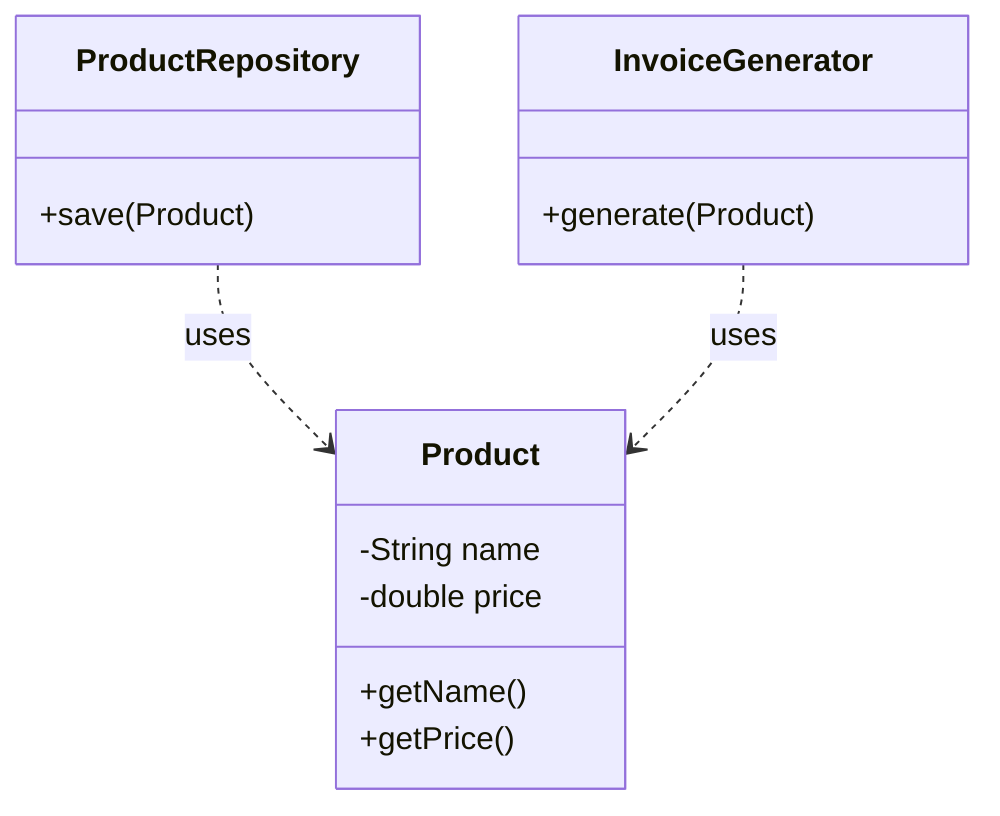
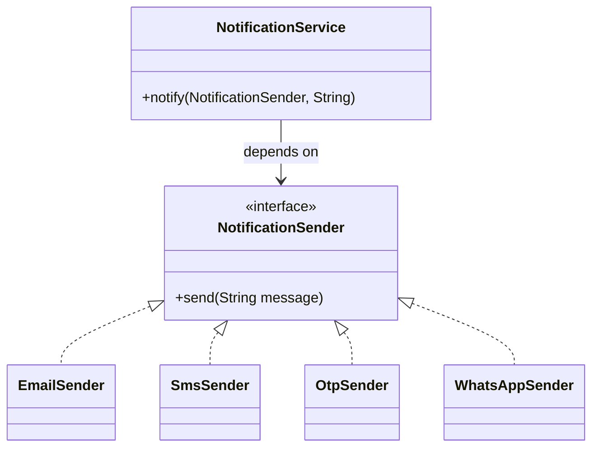
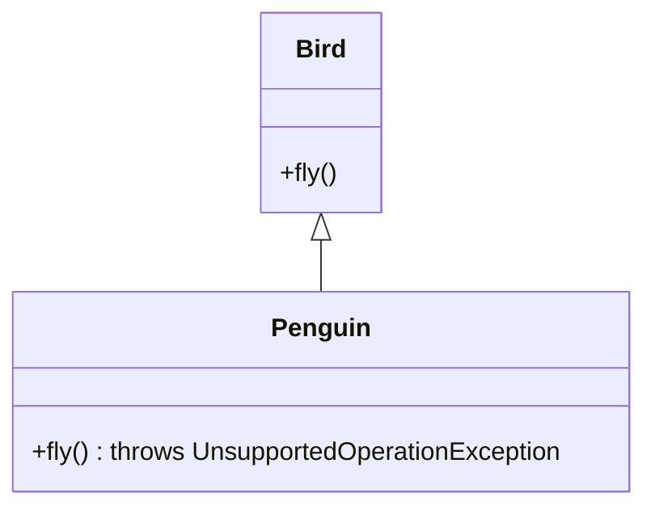
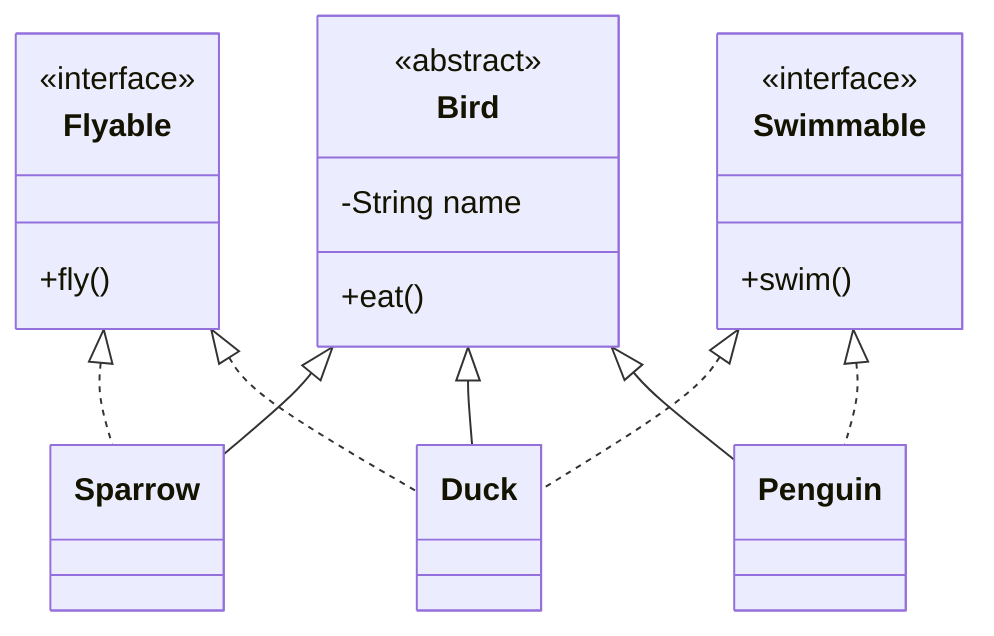
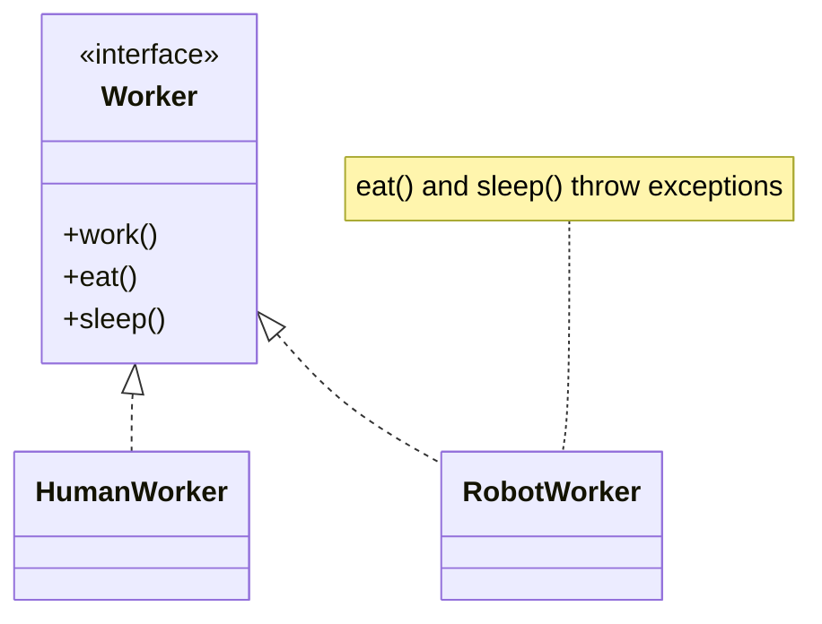
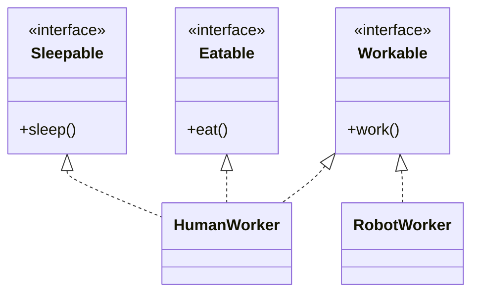
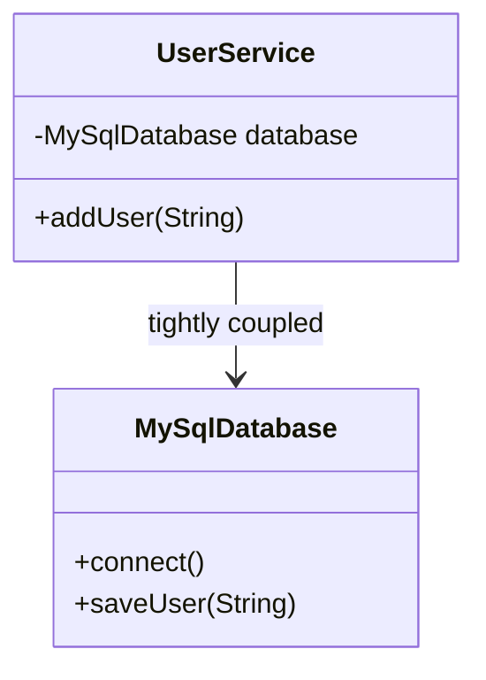
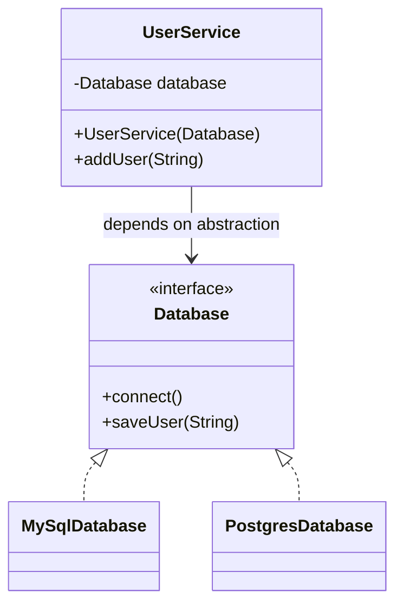

# 🧱 SOLID Principles in Java

The five SOLID design principles, each shown with a **❌ Before** (violation) and a **✅ After** (fix) example, plus class diagrams and a runnable demo.

| Letter | Principle | One-liner | Example |
|:---:|---|---|---|
| **S** | [Single Responsibility](#s--single-responsibility-principle-srp) | A class should have only one reason to change | Product → Repository + Invoice |
| **O** | [Open / Closed](#o--openclosed-principle-ocp) | Open for extension, closed for modification | Notification senders |
| **L** | [Liskov Substitution](#l--liskov-substitution-principle-lsp) | Subclasses must be usable in place of their parent | Birds & Penguins |
| **I** | [Interface Segregation](#i--interface-segregation-principle-isp) | Don't force classes to implement methods they don't use | Human vs Robot worker |
| **D** | [Dependency Inversion](#d--dependency-inversion-principle-dip) | Depend on abstractions, not concrete classes | MySQL / Postgres database |

---

## 📁 Project Structure

```
SOLID/
├── pom.xml
├── README.md
└── src/main/java/org/example/solid/
    ├── SolidDemo.java            ← runs ALL examples
    ├── srp/  ├── before/  ├── after/  └── SrpDemo.java
    ├── ocp/  ├── before/  ├── after/  └── OcpDemo.java
    ├── lsp/  ├── before/  ├── after/  └── LspDemo.java
    ├── isp/  ├── before/  ├── after/  └── IspDemo.java
    └── dip/  ├── before/  ├── after/  └── DipDemo.java
```

Each principle has its own package with a `before` folder (the problem), an `after` folder (the solution) and a `*Demo.java` that runs both.

---

## ▶️ How to Run

**Requirements:** Java 17+

**Option 1 – IntelliJ / Eclipse:** open the `SOLID` folder as a Maven project and run `SolidDemo.java` (or any single `*Demo.java`).

**Option 2 – Maven:**
```bash
cd SOLID
mvn compile
java -cp target/classes org.example.solid.SolidDemo
```

**Option 3 – Plain javac:**
```bash
cd SOLID
javac -d out $(find src -name "*.java")
java -cp out org.example.solid.SolidDemo
```

---

## S – Single Responsibility Principle (SRP)

> **"A class should have only one reason to change."**

### ❌ Before
`Product` stores data **and** saves to the database **and** generates invoices. A change to the DB or the invoice format means editing `Product`.



### ✅ After
Each class has exactly **one** job.



```java
Product product = new Product("Laptop", 55000);
new ProductRepository().save(product);
new InvoiceGenerator().generate(product);
```

📂 [`srp/`](src/main/java/org/example/solid/srp)

---

## O – Open/Closed Principle (OCP)

> **"Software entities should be open for extension, but closed for modification."**

### ❌ Before
Adding a new channel (e.g. WhatsApp) means **modifying** the `if / else-if` chain inside `NotificationService`.

```java
if (type.equals("EMAIL")) { ... }
else if (type.equals("SMS")) { ... }
else if (type.equals("OTP")) { ... }
// ➕ every new type = edit this class again
```

### ✅ After
New channels are added by creating a **new class**. `NotificationService` never changes.



```java
NotificationService service = new NotificationService();
service.notify(new EmailSender(), "Your order is confirmed");
service.notify(new WhatsAppSender(), "Your order is confirmed"); // new, zero changes elsewhere
```

📂 [`ocp/`](src/main/java/org/example/solid/ocp)

---

## L – Liskov Substitution Principle (LSP)

> **"Objects of a subclass should be replaceable with objects of the superclass without breaking the program."**

### ❌ Before
`Bird` assumes every bird can fly. `Penguin extends Bird` but throws an exception from `fly()`, so code that works with `Bird` **crashes** when given a `Penguin`.



### ✅ After
`Bird` keeps only what **all** birds share (`eat()`). Abilities are split into `Flyable` and `Swimmable`, and each bird implements only what it can really do.



```java
BirdWatcher watcher = new BirdWatcher();
watcher.watchFly(new Sparrow());
watcher.watchSwim(new Penguin());
// watcher.watchFly(new Penguin()); ← compile error, so the bug can't happen
```

📂 [`lsp/`](src/main/java/org/example/solid/lsp)

---

## I – Interface Segregation Principle (ISP)

> **"Clients should not be forced to depend on methods they do not use."**

### ❌ Before
One "fat" `Worker` interface forces `RobotWorker` to implement `eat()` and `sleep()`, which it can only fill with exceptions.



### ✅ After
Small, focused interfaces. Each class picks only what it needs.



📂 [`isp/`](src/main/java/org/example/solid/isp)

---

## D – Dependency Inversion Principle (DIP)

> **"High-level modules should not depend on low-level modules. Both should depend on abstractions."**

### ❌ Before
`UserService` (high-level) creates `MySqlDatabase` (low-level) itself with `new`. Switching to Postgres means editing `UserService`.



### ✅ After
Both depend on the `Database` interface. The concrete database is **injected** through the constructor.



```java
new UserService(new MySqlDatabase()).addUser("Sohrab");
new UserService(new PostgresDatabase()).addUser("Sohrab"); // swapped, UserService untouched
```

📂 [`dip/`](src/main/java/org/example/solid/dip)

---

## 🖥️ Sample Output

```
=== SRP: Before ===
[before] Saving Laptop to database
[before] Invoice -> Laptop : Rs 55000.0
=== SRP: After ===
[after] Saving Laptop to database
[after] Invoice -> Laptop : Rs 55000.0

=== OCP: Before ===
[before] Sending Email
[before] Sending SMS
=== OCP: After ===
[after] Email: Your order is confirmed
[after] SMS: Your order is confirmed
[after] OTP: Your order is confirmed
[after] WhatsApp: Your order is confirmed

=== LSP: Before ===
[before] Crash: Penguins cannot fly!
=== LSP: After ===
[after] Sparrow is flying
[after] Duck is flying
[after] Duck is swimming
[after] Penguin is swimming
[after] Penguin is eating

=== ISP: Before ===
[before] Robot is working
[before] Crash: Robots don't eat!
=== ISP: After ===
[after] Human is working
[after] Robot is working
[after] Human is eating

=== DIP: Before ===
[before] Connecting to MySQL...
[before] Saving user to MySQL: Sohrab
=== DIP: After ===
[after] Connecting to MySQL...
[after] Saving user to MySQL: Sohrab
[after] Connecting to PostgreSQL...
[after] Saving user to PostgreSQL: Sohrab
```

---

## 🧠 Quick Revision

| Principle | Smell (when it's broken) | Fix |
|---|---|---|
| **SRP** | One class does DB + business logic + formatting | Split into focused classes |
| **OCP** | Growing `if / else` or `switch` on a type | Interface + one class per variant |
| **LSP** | Subclass throws `UnsupportedOperationException` | Redesign the hierarchy around real abilities |
| **ISP** | Empty or exception-throwing method implementations | Break big interfaces into small ones |
| **DIP** | `new ConcreteClass()` inside a service | Depend on an interface, inject the implementation |

---

👤 **Author:** [Md Sohrab](https://github.com/mdsohrab)
